# UTS Gen-AI Civil & Environmental Engineering Hackathon 2026
## Master Strategy & Execution Plan

> [!IMPORTANT]
> **Submission Deadline:** Tomorrow, **Thursday 25 June 2026, at 12:00 PM (Noon)**.
> **Format:** A **SINGLE PDF** containing all deliverables for all three scenarios.
> **Submission Email:** [danial.jahedarmaghani@uts.edu.au](mailto:danial.jahedarmaghani@uts.edu.au)
> **Evaluation Check:** Missing any of the three scenarios results in disqualification.

---

## 📅 Timeline & Milestone Plan

With only ~25 hours remaining, we must use a highly structured, parallelizable, and time-boxed approach.

```mermaid
gantt
    title Hackathon Action Plan (June 24 - June 25)
    dateFormat  HH:mm
    axisFormat %H:%M
    
    section Setup & Alignment
    Select Projects & Setup Workspaces :active, a1, 11:00, 11:30
    
    section Scenario 1: LEGO
    Prompting & Visual Generation :a2, 11:30, 13:30
    Lego Specification & Connections :a3, 13:30, 15:00
    Draft Report (2-4 pages) :a4, 15:00, 16:30
    
    section Scenario 2: WesTrac
    Tech Assessment (5 Techs) :b1, 16:30, 18:30
    Fleet Spec Matrix (Today vs 5yrs) :b2, 18:30, 20:30
    Workforce & Leadership Recommendations :b3, 20:30, 22:00
    
    section Scenario 3: Intersection
    Austroads Technical Exploration & Prompt :c1, 22:00, 23:30
    Mix Design Plan & Trade-off Matrix :c2, 23:30, 01:00
    
    section Final Assembly
    Final Review & Reflection Writing :d1, 08:00, 10:00
    PDF Compilation & Formatting :d2, 10:00, 11:30
    Submission Email :crit, d3, 11:30, 12:00
```

---

## 🎯 Deliverables Checklist by Scenario

### Scenario 1: LEGO Resilient & Sustainable Infrastructure
* [ ] **Final/Optimum Prompt** (specifically tailored for ChatGPT to get structure, views, and materials).
* [ ] **AI-Generated Visuals** (Front, Top, and Side views of the structure with clear LEGO representation).
* [ ] **Detailed LEGO Spec** (component breakdown, piece types, colors, connection details).
* [ ] **Engineering Report (2–4 pages)** covering:
  - Design Concept & Aesthetic Integration
  - Structural Stability & Feasibility
  - Functionality & Adaptive Design
  - Environmental / Sustainability / Climate Resilience features
  - Methodology of Gen-AI use (prompts, iterations, refinement).

---

### Scenario 2: Future Worksite (WesTrac® / CAT)
* [ ] **Project Selection**: Select a specific Australian project type (e.g., *Regional Highway Upgrade* like the Pacific Highway or *Urban Light Rail Corridor* like the Parramatta Light Rail).
* [ ] **Final Prompts** (up to 400 words total across all tasks).
* [ ] **Technology Assessment Summary** (≤300 words) justifying **5 key emerging technologies** (e.g., semi-autonomous grading, electric drivetrains, telemetry/digital twins, smart compaction, etc.).
* [ ] **Equipment Fleet Comparison Matrix** (Today vs. 5 Years from now) analyzing:
  - Machine selection & configuration (earthworks/compaction/placement)
  - Grade control, set-out, and site measurement technology
  - Material handling & interaction with specs
  - Emissions profile, fuel types, and carbon-reduction trade-offs
  - Noise, ground disturbance, and environmental boundary compliance
  - Productivity, safety (e.g., geofencing/detect), and TCO (Total Cost of Ownership)
  - Explicit engineer validation notes flagging AI assumptions/limitations.
* [ ] **Workforce Assessment & Recommendations** (≤400 words) addressing WesTrac training, recruitment, skills shift, automated roles vs. critical human skills, and **3 high-priority recommendations** to senior leadership.
* [ ] **Critical Reflection** (100–150 words) outlining where Gen-AI fell short and where professional engineering judgment was required.

---

### Scenario 3: Smart Intersection (Kypreos Group)
* [ ] **Final Prompt** (≤400 words) generating Austroads-compliant smart intersection structures.
* [ ] **Gen-AI Mix Design Plan** (≤500 words) using sustainable pavement, recycled asphalt, or smart materials.
* [ ] **Trade-off Matrix** comparing:
  - Safety (vulnerable road users, mixed modes)
  - Traffic flow efficiency & vehicle throughput
  - Capital cost vs. maintenance cost
  - Carbon footprint (materials, transport, construction)
  - Performance & lifespan.
* [ ] **Critique on Long-Term Benefits** (100–150 words) focusing on public and asset-owner value.

---

## 🛠️ Execution Strategy & Collaborative Workflow

Since I am an AI agent with powerful code generation, analysis, and writing capabilities, and you are the domain engineer, we should divide tasks to maximize speed and quality:

1. **Strategic Decisions (Your Role)**:
   - **Scenario 1**: Choose the target resilient structure (e.g., *flood-resilient stilt house*, *seismic-resistant community shelter*, or *sustainable green-roof office hub*).
   - **Scenario 2**: Confirm the Australian infrastructure project type (e.g., *highway upgrade* or *light rail corridor*).
   - **Scenario 3**: Align on the intersection type (e.g., *mixed-mode urban arterial intersection* or *smart high-throughput roundabout*).
2. **Drafting & Synthesis (My Role)**:
   - Generate optimized prompt structures for each scenario.
   - Run technical analysis, draft the comparative tables, and write report sections.
   - Format everything in professional engineering style (PDF-ready markdown/HTML).
3. **Generation of Visuals & Spec**:
   - I can help design custom prompts to generate images, or we can use code (e.g., SVG, diagramming, or image generation tools) to build high-quality engineering representations.
4. **PDF Compilation**:
   - We will establish a python-based compile pipeline in our workspace using `weasyprint`, `pandoc`, or a custom HTML converter to build a gorgeous, professionally typeset PDF that includes all required screenshots, tables, and prompts.

---

## 🚀 Immediate Next Steps

Let's align on the core choices to start producing the content immediately:
1. **Scenario 1 LEGO structure type**: What type of structure do you want to design?
2. **Scenario 2 WesTrac project type**: Should we select a **regional highway upgrade** (highly suited for heavy fleet comparison) or another option?
3. **Scenario 3 Intersection type**: Are we modeling a multi-modal light rail/arterial intersection?
