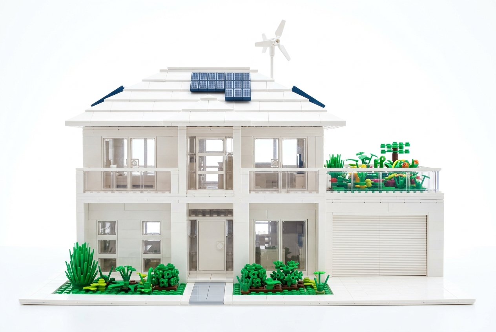
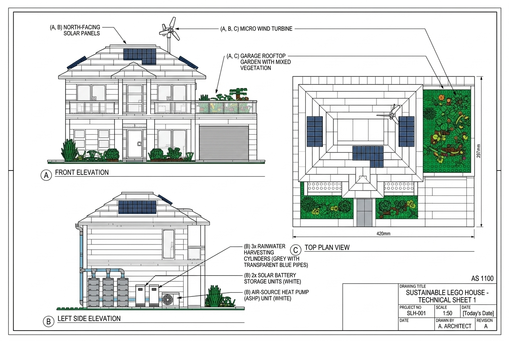
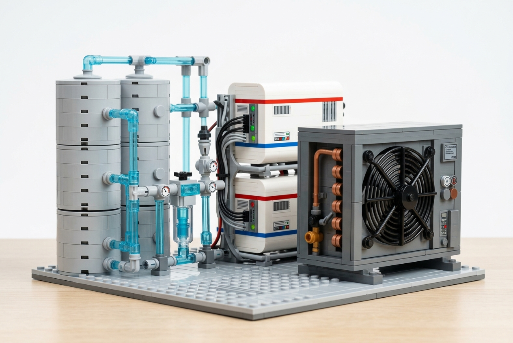

# 1. Scenario 1: LEGO Resilient & Sustainable Infrastructure

## A3 Architectural Board: Urban Sustainable LEGO House

### 1.1 Executive Summary & Design Concept

Rapid urbanization, densification, resource scarcity, and extreme weather events such as urban heat waves demand new paradigms in residential design. This project proposes a **Sustainable Urban LEGO House** presented as a single **A3 architectural board** with a title block, drawing number, revision data, north orientation, scale note, and sheet metadata arranged in the style expected for Australian technical drawings under the AS 1100 drawing-presentation approach.

The house is designed for a Suburban Sydney residential block and uses a double-storey LEGO layout on a light grey baseplate representing the site boundary. It consists of a main two-story section on the left, a first-floor garage on the right with a rooftop garden terrace on top of the garage (acting as the only rooftop garden), a landscaped ground-level front garden, and clear living zones. The design applies Passivhaus principles through a highly insulated envelope, airtight junctions, controlled window areas, external shading, a heat pump, and heat recovery ventilation.

The visual language uses realistic house colours and clear system emphasis: bright white and sand-colored exterior walls, white sloped roof tiles, green rooftop and ground vegetation, rainwater harvesting elements, dark solar panels, white battery storage, and subtle technical highlights for energy and water systems. This keeps the board bright, polished, easy to read, and consistent with the visual clarity of LEGO presentation material.

### 1.2 Final/Optimum Gen-AI Prompts

To achieve consistent, high-fidelity visual and technical representations, we utilized a multi-stage prompt engineering approach.

#### *Prompt 1: Aesthetic & Isometric Concept Design*

An ultra-bright, high-key studio photo of an architectural LEGO model of a modern sustainable double-storey suburban house in Sydney, viewed from a direct, straight-on front perspective. The entire house structure, including the walls, columns, window frames, and garage, is built exclusively from pure white LEGO bricks. The sloped roof is covered in pure white LEGO tiles, reflecting maximum bright light. The model is on a white baseplate and set against a pure white studio background with flat, shadowless overexposed lighting, completely eliminating all dark areas and shadows. All systems are clearly visible from this front view: dark blue solar panels on the white roof, a white micro wind turbine, a colorful green rooftop garden on the garage flat roof, grey rainwater cylinders with transparent blue pipes on the side, white solar battery packs, and a white heat pump unit with a black fan. Large triple-glazed windows show a warm interior glow.

#### *Prompt 2: Technical Schematic & Orthographic Views*

A professional, clean, technical architectural drawing sheet formatted as an A3 landscape board for the sustainable LEGO house shown in the reference image. The drawing features exactly three orthographic projections on a white background: Front Elevation, Left Side Elevation, and Top Plan View, rendered in a clean, professional LEGO brick blueprint style. The elevations and details must be identical to the reference image: a two-storey house built entirely of pure white LEGO bricks with a sloped white tiled roof, containing solar panels and a wind turbine. The garage is on the right with a white roller door and a green rooftop garden. The left side of the front facade displays three grey rainwater cylinders with transparent blue pipes, two white battery storage units, and a white air-source heat pump unit. There are thin, neat black leader lines and technical text labels pointing to: 'North-Facing Solar Panels', 'Micro Wind Turbine', 'Garage Rooftop Garden', 'Rainwater Harvesting Cylinders', 'Solar Battery Storage', and 'Air-Source Heat Pump'. An AS 1100-style title block is positioned in the bottom-right corner. Clean, high-resolution drafting presentation.

### 1.3 A3 Board Visuals & Technical Diagram

Below are the final AI-generated visual design output and the technical schematic. Together they form the content hierarchy for one A3 sheet: a dominant perspective view and a technical elevation drawing showing exactly three orthographic views (Front Elevation, Left Side Elevation, and Top Plan View) with an integrated AS 1100-style title block, matching standard technical drawing layouts.

#### *1.3.1 Main Perspective Rendering*

#### *1.3.2 Technical Board Diagram*

### 1.4 Detailed Component & Connection Breakdown

The structural and mechanical assemblies are categorized into **Substructure (Foundation)**, **Superstructure (Insulated Envelope)**, and **Utility/Sustainability Systems**. The board uses consistent visual coding so each feature is easy to identify: green for vegetation, blue for water, dark blue/black for solar PV, white for battery storage, and grey for heat pump/mechanical services.

#### *4.1.1 Bill of Materials (BOM) & Specifications*

| Assembly | LEGO Part Name / Description | Part ID | Color | Qty | Function & Connection Method |
| --- | --- | --- | --- | --- | --- |
| Substructure | Baseplate 32 x 32 Studs | 3811 | Light Gray | 1 | Represents urban site boundary; anchors ground footings. |
| Substructure | Brick 2 x 4 (Foundation Footings) | 3001 | Medium Gray | 12 | Elevates the floor slab and establishes solid level foundation. |
| Superstructure | Support Plate 16 x 16 | 91405 | Medium Gray | 1 | High-mass concrete-style floor slab. |
| Superstructure | Brick 1x2, 1x4, 1x6 (Wall Bricks) | Various | White / Sand-colored | 145 | Insulated double-walls combining white masonry and sand-colored ground level panels. |
| Superstructure | Window 1 x 2 x 2 Flat | 60592 | White / Clear | 8 | Triple-glazed window blocks in insulated frames. |
| Superstructure | Door 1 x 4 x 6 Frame with Pane | 60623 | White / Clear | 1 | Front entry door with airtight seals. |
| Utilities | Tile 2 x 4 (Solar PV Panels) | 87079 | Dark Blue / Black | 16 | North-facing sloped roof photovoltaic array. |
| Utilities | Garage Door 1x4x6 | 42107 | White | 1 | Functional roller garage door. |
| Utilities | Propeller 3-Blade 5.5L | 30332 | White | 1 | Rooftop micro wind turbine positioned above roof turbulence. |
| Utilities | Cylinder 1 x 1 x 5 (Rainwater) | 3062b | White | 3 | Rainwater harvesting and greywater storage tanks. |
| Utilities | Brick 2x2 with Grille (Heat Pump) | 3003/2412 | White | 1 | Air-source heat pump compressor split units. |
| Utilities | Brick 1x2x3 (Battery Storage) | 22885 | White | 2 | Wall-mounted solar battery storage banks (Tesla Powerwalls). |
| Landscape | Plant Leaves 6 x 5 | 2417 | Green | 15 | Rooftop garden vegetative buffer. |

#### *1.4.2 Mechanical Connections & Assembly Method*

Below is a detailed close-up image showing the mechanical assembly and plumbing connections of the sustainable utility systems located on the service side of the house.

#### *1.4.3 Utility & Mechanical Close-up*

The mechanical interlocking techniques and connections are structured below:

| Connection Element | LEGO Part & Assembly Technique | Engineering Function & Real-World Analog |
| --- | --- | --- |
| **Airtight Masonry Interlock** | Running bond with staggered joints, using thin Technic flexible hoses representing sealing gaskets. | Simulates double-skin insulated walls and forms an airtight envelope with compression seals. |
| **Foundation Anchor** | Technic pins and studs locking foundation footings directly to baseplate. | Anchors the superstructure to establish structural stability and high shear/sliding resistance. |
| **Glazing Sealing** | Press-fitting window frames with a 1-stud recess overlap in the wall cavity. | Eliminates air infiltration and minimizes thermal bridging at window-to-wall interfaces. |

### 1.5 Structural Stability, Orientation & Passivhaus Engineering

#### *1.5.1 Gravity and Environmental Load Paths*

The gravity and environmental structural paths are detailed below:

| Structural Layer | LEGO Implementation | Load Path & Stability Role |
| --- | --- | --- |
| **Roof & Solar Arrays** | 33-degree sloped plates resting on A-frame truss blocks. | Receives environmental wind/rain loads; transfers gravity loads downward to walls. |
| **Superstructure Walls** | Double-skin interlocking running-bond bricks (1x2, 1x4, 1x6). | Acts as load-bearing columns; transfers gravity load to slab and resists lateral shear. |
| **Base Slab** | Support Plate 16x16 anchored to footings. | Acts as structural floor diaphragm; distributes gravity loads to foundation footings. |
| **Foundation Footings** | 12 medium grey 2x4 bricks resting on light grey baseplate studs. | Acts as shallow foundation pads; transfers load evenly to baseplate ground. |

#### *1.5.2 Strategic Placement & Solar Orientation*

The solar orientation and placement strategies for Suburban Sydney are detailed below:

| Design Element | Orientation & Placement Criteria | Sustainable Engineering Benefit |
| --- | --- | --- |
| **Main Glazing & Solar Roof** | Oriented true North (Australian Southern Hemisphere layout). | Maximizes winter passive solar heat gain and optimizes solar PV electricity production. |
| **Roof Pitch** | Set at approximately 33 degrees. | Optimized for Suburban Sydney's latitude to maximize solar capture across seasons. |
| **Eaves Projection** | Extends outward by 2 studs. | Provides self-shading: blocks high-angle summer sun but admits low-angle winter sun. |
| **Utility Systems** | Rainwater tanks, battery storage, and heat pump placed on the south service side. | Minimizes piping length, keeps equipment shaded, and maximizes gravity rainwater collection. |
| **Rooftop Garden** | Located above the garage on the flat roof terrace. | Reduces stormwater peak runoff, provides evaporative cooling, and insulates garage ceiling. |

#### *1.5.3 Integrated Sustainability Microgrid & Thermal Systems*

The integrated sustainability subsystems are detailed below:

| Subsystem | LEGO Visual Representation | Engineering Principle & Integration |
| --- | --- | --- |
| **Passivhaus Envelope** | Double-wall beige bricks with recessed triple-glazed frames. | Continuous insulation and airtightness; paired with HRV to minimize HVAC load. |
| **Solar & Wind Microgrid** | North-facing dark blue PV tiles, white wind turbine, and white battery bricks. | Generates clean electricity, stores energy, and supplies local residential loads. |
| **Rainwater Harvesting** | Light grey cylinders, blue connecting pipes, and green roof garden. | Captures roof runoff, stores water, reduces runoff peaks, and supplies greywater. |
| **Space Heating & Cooling** | Grey external heat pump block with fan grille detail. | Provides highly efficient heat transfer for indoor climate control. |

### 1.6 Gen-AI Collaboration Methodology & Reflection

#### *1.6.1 Interactive Prompt Iteration*

The collaboration methodology and prompt calibration details are outlined below:

| Design Problem | Gen-AI Prompt Refinement | Visual & Technical Result |
| --- | --- | --- |
| **House Scale & Layout** | Specified 'double-storey urban house with a garage and rooftop terrace'. | Moved from a toy model to a realistic residential architectural concept. |
| **Visual Material Appeal** | Included detailed textures: 'beige, white, and wood-toned bricks', 'light slate tiles'. | Avoided flat colors; achieved a premium, professional LEGO website render style. |
| **Technical Consistency** | Instructed exactly three orthographic projections (Front, Side, Top) with an AS 1100 title block. | Created a clean A3 landscape schematic with aligned views and formal title block. |

#### *1.6.2 Engineering Judgment vs. AI Limitations*

The critical comparison of AI design output and human engineering corrective judgment is detailed below:

| AI Design Concept Limitation | Engineering Critique & Correction | Real-World Feasibility Logic |
| --- | --- | --- |
| **Excessive floor-to-ceiling glass on all facades.** | Replaced with controlled glazing sizes and insulated window frames. | Maintains thermodynamic envelope stability to prevent massive thermal heat gains/losses. |
| **Floating or structurally unsupported solar panels.** | Specified mounting solar tiles on 33° sloped roof tiles using hinge mounts. | Ensures secure mechanical connections capable of withstanding wind and gravity loads. |
| **Omission of mechanical ventilation in an airtight structure.** | Integrated MVHR ventilation combined with air-source heat pump. | Ensures healthy indoor air quality and heat recovery in a sealed Passivhaus envelope. |